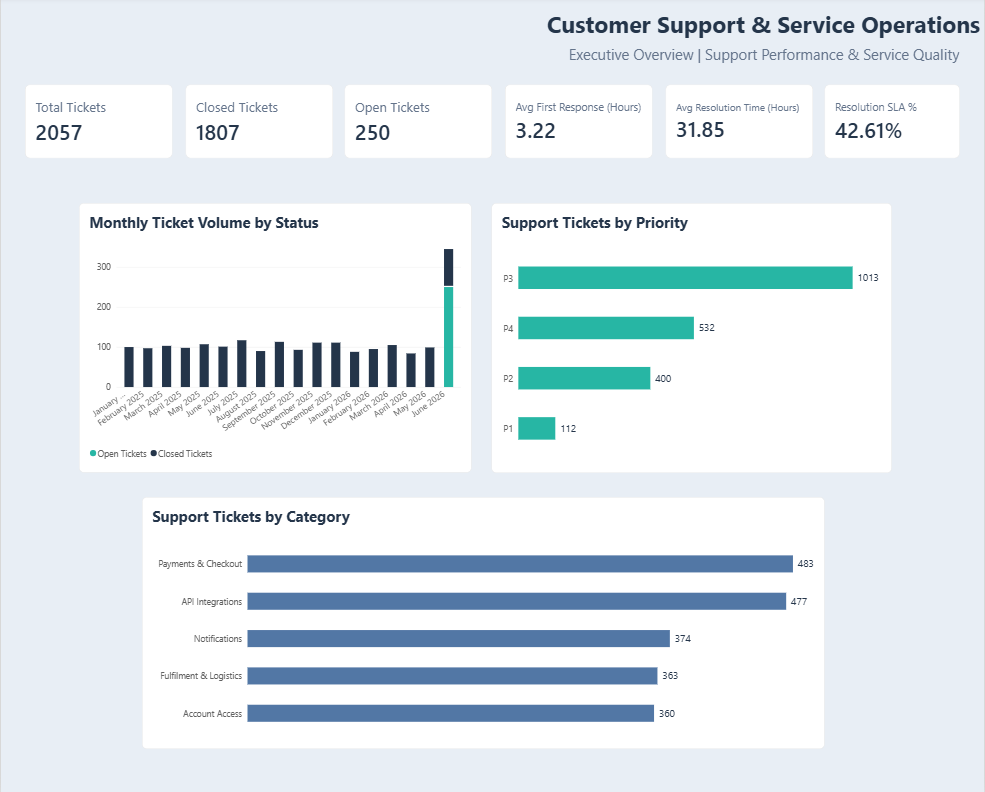
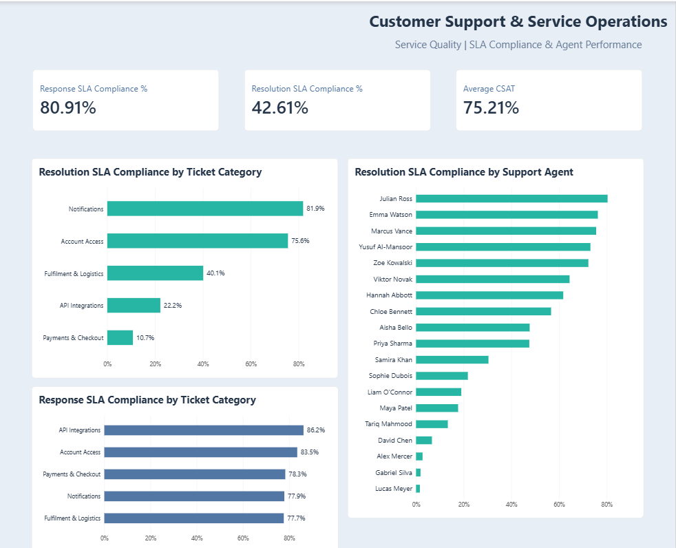

# Customer Support & Service Operations Analytics

**Power BI | DAX | Power Query | Business Intelligence**

## Project Overview

Developed an interactive Power BI dashboard to analyze **2,057 customer support tickets**, evaluate service efficiency, monitor SLA compliance, and identify operational improvement opportunities.

The project covers data preparation, star schema modeling, DAX calculations, KPI validation, and business insights.

## Dashboard Preview

### Executive Overview

### Service Quality & Agent Performance

## Tools & Skills

- **Power BI:** Interactive dashboards and KPI visualization
- **Power Query:** Data preparation and validation
- **DAX:** Business metrics and SLA calculations
- **Data Modeling:** Star schema with Tickets, Agents, Merchants, and DateTable
- **Business Analysis:** Operational insights and recommendations

## Dataset & Key Metrics

The dataset includes **2,057 tickets, 20 support agents, and 112 merchants**.

| KPI | Result |
|---|---:|
| Total Tickets | 2,057 |
| Closed Tickets | 1,807 |
| Open Tickets | 250 |
| Avg First Response Time | 3.22 hours |
| Avg Resolution Time | 31.85 hours |
| Response SLA Compliance | 80.91% |
| Resolution SLA Compliance | 42.61% |
| Average CSAT | 75.21% |

## Key Business Insights

**1. Resolution performance needs attention.**

Response SLA compliance reached 80.91% among tickets with recorded first responses, while resolution SLA compliance was 42.61% among closed tickets. These metrics use different eligible populations but highlight the need to examine resolution workflows.

**2. Payments & Checkout has a significant SLA gap.**

This category recorded 78.3% response SLA compliance but only 10.7% resolution SLA compliance, making it a priority for further operational investigation.

**3. Open tickets require assignment review.**

All 250 open tickets were unassigned and had no recorded first-response timestamp. This pattern warrants investigation into ticket assignment processes.

**4. Customer satisfaction requires context.**

Average CSAT was 75.21%, based on 225 ratings covering only 10.9% of tickets. This limits how representative the result may be.

## Data Validation Highlight

During KPI validation, I identified that **250 open tickets without recorded first responses were incorrectly included as SLA-compliant** in the original response metric.

I investigated the underlying ticket records and revised the DAX calculation to include only tickets with recorded first responses.

**Response SLA: 83.23% → 80.91%**

This correction demonstrates the importance of validating KPI business logic before using dashboard results for decision-making.

## Recommendations

- Investigate resolution delays in Payments & Checkout and API Integrations.
- Review assignment workflows for open tickets.
- Monitor response and resolution SLA separately.
- Improve CSAT feedback coverage.
- Evaluate agent performance alongside workload and ticket complexity.

## Project Notes

Response SLA measures compliance among tickets with recorded first responses; resolution SLA measures compliance among closed tickets. Monthly ticket status reflects the recorded status grouped by creation month, not historical month-end status.
